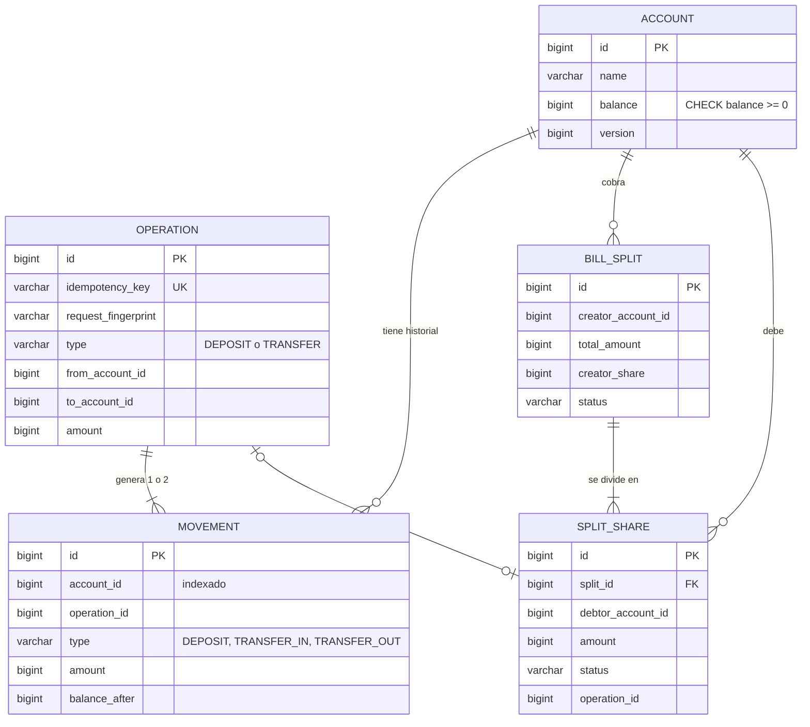
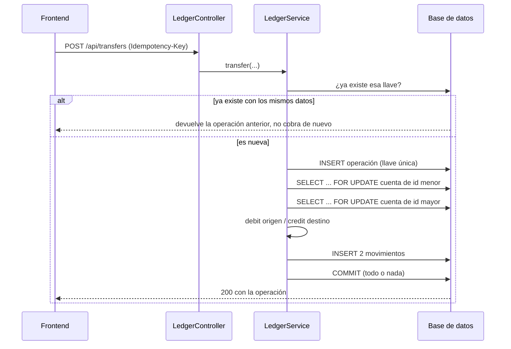

# Vaca · Billetera entre personas

**Video (demo y decisiones, 5 min):** https://youtu.be/D0oH-EuJV2M

Un sistema para que un grupo de personas se mueva plata sin pasar por el banco, con una regla que no se negocia: **no puede perder un peso**.

Además del núcleo (crear cuenta, cargar saldo, transferir, consultar saldo e historial), construí **la vaca**: quien pagó la cena divide la cuenta, y a cada participante le aparece cuánto debe, a quién y por qué. Paga con un clic y la cuenta se cierra sola cuando nadie debe nada. Y si en un grupo hay varias vacas cruzadas, **"¿Quién le paga a quién?"** calcula un plan con pocas transferencias para quedar a paz y salvo.

- **Backend:** Java 17, Spring Boot 3.3, Spring Data JPA, H2
- **Frontend:** Angular 18 (componentes standalone, signals, formularios reactivos)
- **Pruebas:** JUnit 5 y AssertJ, con pruebas de concurrencia

## Cómo correrlo

Requisitos: Java 17 o superior y Node 18 o superior.

```bash
# Backend (http://localhost:8080, documentación en /swagger-ui.html)
cd backend
./mvnw test             # 27 pruebas, incluidas las de concurrencia
./mvnw spring-boot:run  # en PowerShell: .\mvnw "spring-boot:run"

# Frontend (http://localhost:4200)
cd frontend
npm install
npm start
```

La auditoría está en `GET /api/audit` y también se ve en la pantalla principal.

## Diseño

Lo documenté con UML y un modelo entidad-relación, como aprendí en Diseño y Programación Orientada a Objetos y en Fundamentos de Bases de Datos. GitHub dibuja estos diagramas automáticamente.

### Capas y clases principales


La regla de diseño más importante: **solo `LedgerService` cambia saldos.** La vaca no mueve plata por su cuenta; llama a `transfer`, así que hereda todas sus protecciones.

### Modelo de datos



### Qué pasa en una transferencia



### "¿Quién le paga a quién?"

Calculo el saldo neto de cada persona con las partes pendientes del grupo y aplico un algoritmo voraz con dos colas de prioridad (montículos), como las de Estructuras de Datos: quien más debe le paga a quien más le deben, por el menor de los dos montos. Cada paso deja al menos a una persona en cero, así que el plan tiene como máximo *n − 1* transferencias. Encontrar el mínimo exacto es NP-difícil, y por eso uso esta aproximación práctica. Hoy el plan es una sugerencia: los pagos se siguen haciendo parte por parte.

---

## 01. Decisiones clave y por qué las tomé

- **Spring Boot + Angular:** es el stack que mejor domino. Lo he usado de forma constante durante este semestre en Ingeniería de Software Moderna, con retroalimentación y revisiones de código, y lo tengo muy reciente. Para un sistema que mueve plata preferí la tecnología donde entiendo cada línea, en vez de aprender un framework nuevo en 72 horas.
- **Montos en pesos enteros (`long`), nunca `double`:** con decimales binarios, 0,1 + 0,2 no da 0,3, y con plata eso no es aceptable. Los bancos guardan centavos porque calculan intereses, el 4×1000 y comisiones; este sistema solo mueve plata entre personas, y eso nunca genera fracciones de peso. Lo consulté con el equipo de selección de Habi y me confirmaron que pesos enteros está bien. Si después hubiera comisiones porcentuales, cambiaría la unidad a centavos, que sigue siendo un entero: solo cambia la escala.
- **Un libro de movimientos que nunca se modifica:** cada carga o transferencia crea movimientos inmutables. El saldo se guarda en la cuenta para consultarlo rápido, pero siempre debe coincidir con la suma del historial, y la auditoría lo verifica.
- **Todo cambio de plata pasa por un solo servicio (`LedgerService`):** un solo lugar donde revisar, probar y proteger.
- **H2 en archivo y todo local:** corre sin instalar nada. En producción usaría PostgreSQL; el código no cambia porque todo pasa por JPA. No lo desplegué en internet porque el reto no lo pide y preferí invertir el tiempo en que no pierda plata.
- **La vaca como funcionalidad extra:** la escogí por dos razones. La primera es el contexto: en un extracto bancario solo dice "transferencia de Beto", y cuando toca hacer la declaración de renta uno no sabe qué fue cada movimiento. Aquí queda claro que "Beto pagó su parte de la cena de cumpleaños". La segunda es que lo vivo en carne propia: todos los meses divido con mis roomies el arriendo, el mercado y los servicios, y es tedioso. Por eso puedo ser crítico con lo que construí.
- **El peso de más rota por turnos (idea mía):** al dividir 100.000 entre 3 sobra un peso. Al principio lo asumía siempre quien cobraba, pero si el mismo grupo divide cada semana, esa persona termina poniendo más que los demás. Ahora el sistema lleva la cuenta de cuántos pesos de más ha puesto cada uno y le asigna el siguiente a quien menos lleva. Una limitación: si dos divisiones del mismo grupo se crean exactamente al mismo tiempo, el turno podría repetirse. Eso solo afecta en un peso a quién le toca, nunca la plata total.

## 02. Cómo sé que mi sistema no pierde un peso

| Qué puede salir mal | Cómo lo protejo | Evidencia |
| --- | --- | --- |
| Dos transferencias simultáneas gastan el mismo saldo | Bloqueo pesimista de las cuentas (`SELECT … FOR UPDATE`) dentro de una transacción | `ConcurrencyTest.elMismoSaldoNoSePuedeGastarDosVeces`: 10 transferencias del saldo completo en paralelo, solo 1 pasa |
| Bloqueo mutuo entre A→B y B→A al mismo tiempo | Bloqueo las dos cuentas siempre en el mismo orden (id menor primero) | `milTransferenciasSimultaneasConservanLaPlataTotal` termina sin bloquearse |
| Doble clic o reintento por falla de red cobra dos veces | Llave de idempotencia única por operación. El frontend la conserva si falla la red y la cambia cuando la operación termina | `reintentosSimultaneosConLaMismaLlaveSoloCobranUnaVez`: 8 reintentos simultáneos, 1 cobro |
| Misma llave reutilizada con otro monto | Guardo una huella de la petición; si no coincide, la rechazo | `reusarUnaLlaveConOtrosDatosEsRechazado` |
| La operación queda a medias (se descuenta pero no se abona) | Una sola transacción: saldos, historial y registro se aplican completos o nada | `saldoInsuficienteNoMueveNada`, `transferirACuentaInexistenteNoDescuentaNada` |
| Saldo negativo | Validación en el código y restricción `CHECK (balance >= 0)` en la base de datos | Pruebas de saldo insuficiente |
| Montos inválidos o absurdos | Mayor que cero y tope de $10.000.000 por operación | `montosInvalidosSonRechazados` |
| Desbordamiento numérico | `Math.addExact` lanza un error en vez de dar un saldo negativo | — |
| Dividir 100.000 entre 3 pierde o crea pesos | Partes enteras más un chequeo explícito de que la suma es exactamente el total. Los pesos que sobran se asignan por turnos | `dividirEnPartesIgualesNoPierdeNiCreaPesos`, `elPesoDeMasRotaEntreLasMismasPersonas` |
| El plan de liquidación descuadra los saldos | Verifico que los saldos netos sumen cero antes de calcular, y una prueba confirma que al aplicar el plan todos quedan exactamente en cero | `elPlanDejaATodosExactamenteEnCero` |
| Pagar dos veces la misma parte de la vaca | Bloqueo de la parte; el segundo pago la encuentra pagada | `pagosSimultaneosDeLaMismaParteSoloCobranUnaVez` |
| Plata que aparece o desaparece por un error que no anticipé | Auditoría: suma de saldos = suma de cargas; saldo de cada cuenta = suma de su historial; cada parte pagada tiene su transferencia real | `GET /api/audit`, revisada al final de casi todas las pruebas |

La prueba más fuerte es `milTransferenciasSimultaneasConservanLaPlataTotal`: 20 hilos hacen unas mil transferencias aleatorias entre 10 cuentas y al final la plata total es exactamente la misma, ninguna cuenta queda en negativo y cada saldo coincide con su historial.

## 03. Qué dejé fuera y por qué

- **Autenticación y autorización:** hoy cualquiera puede operar sobre cualquier cuenta. Lo consulté con el equipo de selección de Habi y me confirmaron que no es requisito del reto, así que preferí invertir el tiempo en que el sistema no pierda plata. Es lo primero que agregaría: usuario y contraseña cifrada (BCrypt), un token por sesión y validar en el backend que solo puedas mover plata de tu propia cuenta, como hice con el login en proyectos de la universidad.
- **Pasarela de pagos real:** la carga de saldo es simulada, como pide el reto.
- **Reversos y devoluciones:** se harían como una operación compensatoria nueva, nunca editando el historial.
- **Ejecutar el plan de liquidación de una vez:** hoy es una sugerencia. Ejecutarlo requiere pagar varias partes con menos transferencias y ajustar la auditoría, que hoy exige una transferencia por cada parte pagada.
- **Paginación del historial**, notificaciones y recordatorios de cobro.

## 04. Qué haría distinto con más tiempo

- **Desplegarlo en internet:** hoy corre solo en local. Lo subiría con PostgreSQL administrado, el backend en un contenedor y el frontend en un hosting estático, con las URLs configuradas por variables de entorno.
- **Una app móvil:** para dividir cuentas con los roomies, el celular es más cotidiano que una página web. En primer semestre hice apps móviles con FlutterFlow y Firebase (EcoScan y UpWay, esta última presentada en ExpoAndes), y podría construir una que consuma esta misma API.
- **Un dashboard de finanzas:** ya hice uno personal en Google Sheets con Apps Script para registrar mis gastos e ingresos. Aquí serviría para ver en qué se va la plata de cada grupo: arriendo, mercado, servicios, salidas.
- **Centavos:** pasar la unidad a centavos para soportar comisiones, intereses o el 4×1000, sin dejar de usar enteros.
- **PostgreSQL con Testcontainers**, para probar la concurrencia contra la base de datos de producción y no solo contra H2.
- **Migraciones con Flyway** en vez de `ddl-auto=update`.
- **Límites diarios por cuenta** y detección de comportamiento raro.
- **Llave de idempotencia con vencimiento** y asociada a la cuenta que la usa.

## 05. Qué NO sé

- **Cómo se comporta el bloqueo en una base de datos de producción.** Sé qué hace el bloqueo pesimista en mi código y lo comprobé con las pruebas de concurrencia en H2. Lo que no sé es cómo se comporta en PostgreSQL ni cómo interactúa con los niveles de aislamiento; no sabría explicar las diferencias.
- **Cómo escalar esto.** No sé cómo funcionaría con varias instancias del backend al mismo tiempo ni con millones de cuentas.
- **La regulación.** No sé qué normas aplican en Colombia para mover plata entre personas.

## 06. Supuestos

- **Una sola moneda, pesos colombianos sin decimales:** porque el escenario es mover plata entre personas en Colombia, y eso no genera fracciones de peso.
- **Una cuenta por persona y sin autenticación:** porque el reto se centra en que la plata no se pierda, y Habi confirmó que el login no es requisito.
- **El peso que sobra al dividir rota por turnos:** lo pone quien menos pesos de más haya puesto antes, contando todas sus divisiones, y en un empate va primero quien cobra. Así nadie termina pagando siempre de más.
- **Tope de $10.000.000 por operación:** limita el daño de un error o de un abuso. El valor es arbitrario; en la vida real lo definirían el negocio y la regulación.

## 07. Cómo usé IA

Usé Claude como un motor para desarrollar más rápido. La base técnica ya la conocía porque la he trabajado yo mismo: Spring Boot, JPA y Angular en Ingeniería de Software Moderna, SQL en Fundamentos de Bases de Datos y colas de prioridad en Estructuras de Datos. Sin IA habría podido construir una parte, pero me habría tomado mucho más tiempo y seguramente no habría alcanzado a hacer todo lo que hice.

No dejé que la IA lo hiciera todo. No puedo mandarla a construir algo sin saber como mínimo qué está haciendo, así que le daba instrucciones claras, concretas y aterrizadas al reto y a mi nivel.

**Lo que decidí yo:** el stack, la funcionalidad extra, cómo implementarla y por qué, y trabajar por etapas (núcleo, vaca, frontend y mejoras) revisando cada una antes de seguir. También fueron mías la idea de que el peso de más rote por turnos, consultar con Habi si esperaban login y centavos, y dejarlo local en vez de desplegarlo.

**Cómo revisaba:** Claude escribía según mis instrucciones y decisiones. Yo compilaba y corría las pruebas en mi computador, leía el código hasta entender qué hacía y, a partir de los resultados, le daba retroalimentación y nuevas decisiones. Lo que no entendía lo preguntaba o lo buscaba hasta entender qué hacía y cómo.

**Las protecciones del dinero fueron nuevas para mí.** Idempotencia, bloqueos en orden y pruebas de concurrencia: las aprendí en este proyecto, revisando con la IA por qué cada una era necesaria (ver la sección 08).

**Errores de la IA:**

- **El formulario que no enviaba nada:** en el frontend, el formulario de crear cuenta usaba `(ngSubmit)` sin `[formGroup]`. Con formularios reactivos ese evento no se dispara sin la directiva, así que el botón no creaba nada. Se detectó al probar la pantalla con un navegador automatizado: las cuentas nunca aparecían.
- **Tipos que no compilaban:** en las pruebas de la vaca, la IA pasó números como `90_000` donde el constructor espera un `Long`. Java no convierte `int` a `Long` automáticamente, así que no compiló en mi computador. Lo corregimos agregando `L` (`90_000L`); ese arreglo es un commit propio en el historial.
- **Un falso error de pruebas:** después de esa falla, Maven creyó que el código estaba compilado y no encontró las clases al correr las pruebas. Revisando el reporte vimos que no era un error del código sino de la carpeta `target`, y se resolvió con `mvn clean test`.

**Sobre el historial de commits:** construí el proyecto por etapas entre el 9 y el 10 de noviembre, probando cada una en mi computador. Creé el repositorio después, así que los primeros commits reconstruyen esas etapas en orden. Los cambios posteriores, como el peso rotativo y este README, los fui subiendo a medida que los hacía.

## 08. Qué aprendí

**Qué es nuevo para mí.** Cosas que vivía a diario pero nunca había visto como un problema. Dividir una cuenta entre 3 casi nunca da exacto: siempre sobra un peso y alguien tiene que ponerlo. Un doble clic o un reintento por falla de red puede cobrarte dos veces si el sistema no lo evita, y para eso existe la idempotencia. También aprendí por qué bloquear las cuentas siempre en el mismo orden evita que dos transferencias se queden esperándose para siempre.

**Qué me sorprendió.** Que la IA se equivocara en algo tan básico como un tipo de dato (`int` en vez de `Long`). Me confirmó que no puedo entregar nada sin compilarlo y probarlo yo mismo.

**Qué me llevo.** Que para probar que un sistema no pierde plata no basta con probar los casos uno por uno: hay que atacarlo con muchas operaciones al mismo tiempo y verificar que al final la plata total sea la misma. También me llevo haber trabajado en un proyecto difícil con tiempo limitado, saliendo de mi zona de confort y usando las herramientas que tengo para hacer mejor mi trabajo.
