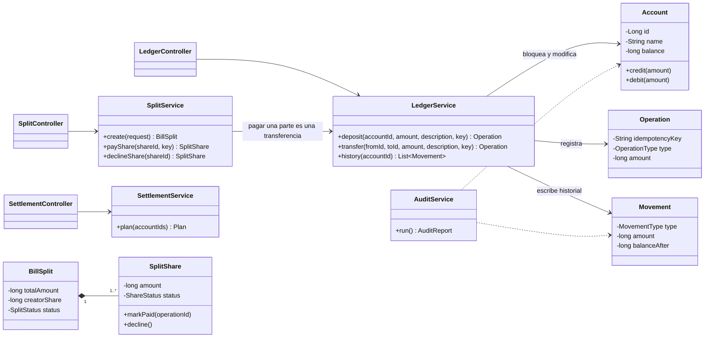
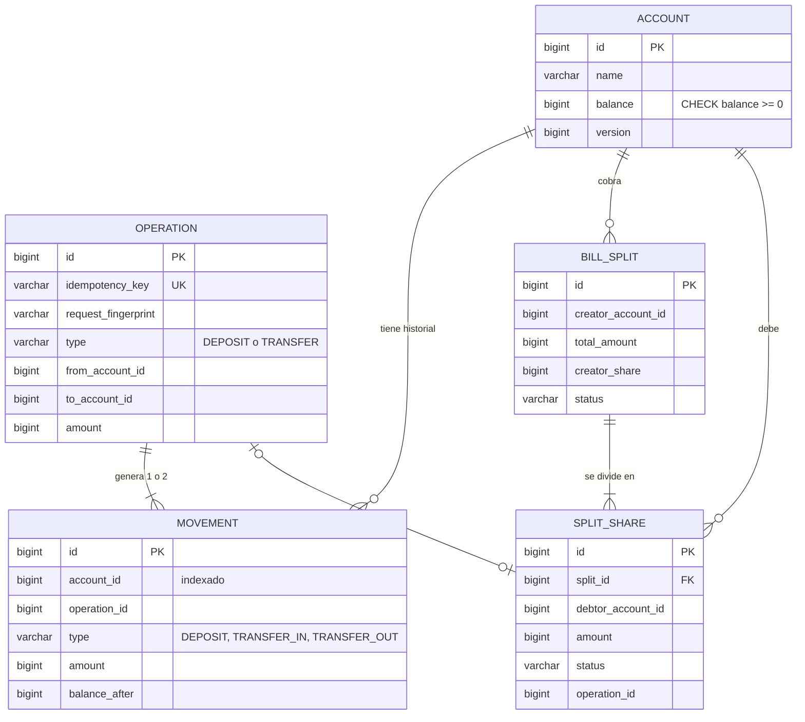
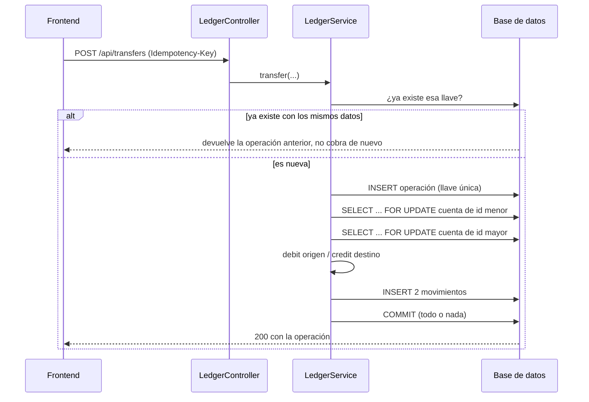

# Vaca · Billetera entre personas

> **BORRADOR. José: reescribe todo con tus palabras antes de entregar.** Las partes marcadas con ✍️ solo las puedes escribir tú. Borra estas notas al final.

Un sistema para que un grupo de personas se mueva plata sin pasar por el banco, con una regla que no se negocia: **no puede perder un peso**.

Además del núcleo (crear cuenta, cargar saldo, transferir, consultar saldo e historial), construí **la vaca**: quien pagó la cena divide la cuenta, y a cada participante le aparece cuánto debe, a quién y por qué. Paga con un clic y la cuenta se cierra sola cuando nadie debe nada. Y si en un grupo hay varias vacas cruzadas, **"¿Quién le paga a quién?"** calcula un plan con pocas transferencias para quedar a paz y salvo.

- **Backend:** Java 17, Spring Boot 3.3, Spring Data JPA, H2
- **Frontend:** Angular 18 (componentes standalone, signals, formularios reactivos)
- **Pruebas:** JUnit 5 y AssertJ, con pruebas de concurrencia

## Cómo correrlo

Requisitos: Java 17 o superior y Node 18 o superior.

```bash
# Backend (http://localhost:8080, documentación en /swagger-ui.html)
cd backend
./mvnw test             # 26 pruebas, incluidas las de concurrencia
./mvnw spring-boot:run  # en PowerShell: .\mvnw "spring-boot:run"

# Frontend (http://localhost:4200)
cd frontend
npm install
npm start
```

La auditoría está en `GET /api/audit` y también se ve en la pantalla principal.

## Diseño

Lo documenté con UML y un modelo entidad-relación, como aprendí en Diseño y Programación Orientada a Objetos y en Fundamentos de Bases de Datos. GitHub dibuja estos diagramas automáticamente.

### Capas y clases principales



La regla de diseño más importante: **solo `LedgerService` cambia saldos.** La vaca no mueve plata por su cuenta; llama a `transfer`, así que hereda todas sus protecciones.

### Modelo de datos



### Qué pasa en una transferencia



### "¿Quién le paga a quién?"

Calculo el saldo neto de cada persona con las partes pendientes del grupo y aplico un algoritmo voraz con dos colas de prioridad (montículos), como las de Estructuras de Datos: quien más debe le paga a quien más le deben, por el menor de los dos montos. Cada paso deja al menos a una persona en cero, así que el plan tiene como máximo *n − 1* transferencias. Encontrar el mínimo exacto es NP-difícil, y por eso uso esta aproximación práctica. Hoy el plan es una sugerencia: los pagos se siguen haciendo parte por parte.

---

## 01. Decisiones clave y por qué las tomé

✍️ *Revisa cada decisión y explica el porqué con tus palabras. Estas son las que tomamos:*

- **Spring Boot + Angular:** es el stack que mejor domino. Para un sistema que mueve plata preferí la tecnología donde entiendo cada línea, en vez de aprender un framework nuevo en 72 horas.
- **Montos en pesos enteros (`long`), nunca `double`:** con decimales binarios 0,1 + 0,2 no da 0,3. El peso colombiano no usa centavos en la práctica, así que un entero de pesos es exacto.
- **Un libro de movimientos que nunca se modifica:** cada carga o transferencia crea movimientos inmutables. El saldo se guarda en la cuenta para consultarlo rápido, pero siempre debe coincidir con la suma del historial, y la auditoría lo verifica.
- **Todo cambio de plata pasa por un solo servicio (`LedgerService`):** un solo lugar donde revisar, probar y proteger.
- **H2 en archivo:** corre sin instalar nada. En producción usaría PostgreSQL; el código no cambia porque todo pasa por JPA.
- **La vaca como funcionalidad extra:** ✍️ *¿por qué esta y no otra? Ejemplo: es el escenario donde más se nota que el banco no entiende el contexto; en un extracto es "transferencia de Beto", aquí es "Beto pagó su parte de la cena de cumpleaños".*

## 02. Cómo sé que mi sistema no pierde un peso

| Qué puede salir mal | Cómo lo protejo | Evidencia |
| --- | --- | --- |
| Dos transferencias simultáneas gastan el mismo saldo | Bloqueo pesimista de las cuentas (`SELECT … FOR UPDATE`) dentro de una transacción | `ConcurrencyTest.elMismoSaldoNoSePuedeGastarDosVeces`: 10 transferencias del saldo completo en paralelo, solo 1 pasa |
| Bloqueo mutuo entre A→B y B→A al mismo tiempo | Bloqueo las dos cuentas siempre en el mismo orden (id menor primero) | `milTransferenciasSimultaneasConservanLaPlataTotal` termina sin bloquearse |
| Doble clic o reintento por falla de red cobra dos veces | Llave de idempotencia única por operación. El frontend la conserva si falla la red y la cambia cuando la operación termina | `reintentosSimultaneosConLaMismaLlaveSoloCobranUnaVez`: 8 reintentos simultáneos, 1 cobro |
| Misma llave reutilizada con otro monto | Guardo una huella de la petición; si no coincide, la rechazo | `reusarUnaLlaveConOtrosDatosEsRechazado` |
| La operación queda a medias (se descuenta pero no se abona) | Una sola transacción: saldos, historial y registro se aplican completos o nada | `saldoInsuficienteNoMueveNada`, `transferirACuentaInexistenteNoDescuentaNada` |
| Saldo negativo | Validación en el código y restricción `CHECK (balance >= 0)` en la base de datos | Pruebas de saldo insuficiente |
| Montos inválidos o absurdos | Mayor que cero y tope de $10.000.000 por operación | `montosInvalidosSonRechazados` |
| Desbordamiento numérico | `Math.addExact` lanza un error en vez de dar un saldo negativo | — |
| Dividir 100.000 entre 3 pierde o crea pesos | Partes enteras más un chequeo explícito de que la suma es exactamente el total; el peso sobrante lo asume quien cobra | `dividirEnPartesIgualesNoPierdeNiCreaPesos` |
| El plan de liquidación descuadra los saldos | Verifico que los saldos netos sumen cero antes de calcular, y una prueba confirma que al aplicar el plan todos quedan exactamente en cero | `elPlanDejaATodosExactamenteEnCero` |
| Pagar dos veces la misma parte de la vaca | Bloqueo de la parte; el segundo pago la encuentra pagada | `pagosSimultaneosDeLaMismaParteSoloCobranUnaVez` |
| Plata que aparece o desaparece por un error que no anticipé | Auditoría: suma de saldos = suma de cargas; saldo de cada cuenta = suma de su historial; cada parte pagada tiene su transferencia real | `GET /api/audit`, revisada al final de casi todas las pruebas |

La prueba más fuerte es `milTransferenciasSimultaneasConservanLaPlataTotal`: 20 hilos hacen unas mil transferencias aleatorias entre 10 cuentas y al final la plata total es exactamente la misma, ninguna cuenta queda en negativo y cada saldo coincide con su historial.

## 03. Qué dejé fuera y por qué

✍️ *Ajusta y explica:*

- **Autenticación y autorización:** hoy cualquiera puede operar sobre cualquier cuenta. Es lo primero que agregaría, pero el reto se centra en no perder plata y preferí invertir el tiempo ahí.
- **Pasarela de pagos real:** la carga de saldo es simulada, como pide el reto.
- **Reversos y devoluciones:** se harían como una operación compensatoria nueva, nunca editando el historial.
- **Ejecutar el plan de liquidación de una vez:** hoy es una sugerencia. Ejecutarlo requiere pagar varias partes con menos transferencias y ajustar la auditoría, que hoy exige una transferencia por cada parte pagada.
- **Paginación del historial**, notificaciones y recordatorios de cobro.

## 04. Qué haría distinto con más tiempo

✍️ *Ejemplos para inspirarte:*

- PostgreSQL con Testcontainers, para probar la concurrencia contra la base de datos de producción y no solo contra H2.
- Migraciones con Flyway en vez de `ddl-auto=update`.
- Límites diarios por cuenta y detección de comportamiento raro.
- Llave de idempotencia con vencimiento y asociada a la cuenta que la usa.

## 05. Qué NO sé

✍️ *Solo tú puedes escribir esto. Sé honesto, lo piden en serio. Preguntas para pensarlo:*

- ¿Sabrías cómo se comporta el bloqueo pesimista en PostgreSQL frente a H2, por ejemplo en los niveles de aislamiento?
- ¿Sabes cómo escalaría esto a varias instancias del backend o con millones de cuentas?
- ¿Qué regulación aplica en Colombia a mover plata entre personas?

## 06. Supuestos

✍️ *Revisa y ajusta:*

- Una sola moneda: pesos colombianos sin decimales.
- Una cuenta por persona y sin autenticación.
- En la vaca, quien cobra asume el peso sobrante del redondeo para no cobrarle de más a nadie.
- El tope de $10.000.000 por operación es arbitrario; en la vida real lo definiría el negocio y la regulación.

## 07. Cómo usé IA

✍️ **Esta sección tiene que ser tuya.** Cuenta tu dinámica real. Lo que pasó en este proyecto, para que lo cuentes a tu manera:

- Usé Claude como compañero. Yo decidí el stack, la funcionalidad extra y cómo trabajar (por etapas, revisando cada una). Claude escribía cada etapa y me la explicaba; yo corría las pruebas en mi computador, leía el código y preguntaba lo que no entendía.
- Claude no podía compilar Java en su entorno, así que la verificación real fue mía: corrí `mvn test` y le devolví los resultados.
- **Un error de la IA:** en el frontend, el formulario de crear cuenta usaba `(ngSubmit)` sin `[formGroup]`. Con formularios reactivos, ese evento no se dispara sin la directiva, así que el botón no creaba nada. Se detectó al probar la pantalla con un navegador automatizado: las cuentas nunca aparecían.
- **Otro error, que detectó el compilador en mi computador:** en las pruebas de la vaca, la IA pasó números como `90_000` donde el constructor espera un `Long`. Java no convierte `int` a `Long` automáticamente, así que no compiló. Lo corregimos agregando `L` (`90_000L`).
- ✍️ *Agrega tus propios momentos: algo que preguntaste, algo que decidiste distinto a lo que sugirió la IA, algo que comprobaste tú.*

## 08. Qué aprendí

✍️ *Solo tú. Por ejemplo: qué es la idempotencia y por qué importa con plata; por qué el orden de los bloqueos evita deadlocks; cómo se prueba la concurrencia.*
